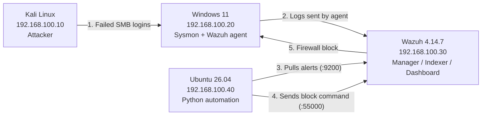

# SOC Automation Lab

**Part 2 of 2** | [← Part 1: Attack-Defend Lab](https://github.com/jonasssam/Attack-Defend-Lab)

> **TL;DR:** I built a 4-VM SOC environment with Wazuh and Sysmon, wrote three of my own detection rules mapped to MITRE ATT&CK, and then wrote a Python program that watches for alerts, decides how serious they are, and automatically blocks the attacker's IP on the Windows machine. Every decision it makes gets saved to an audit log.

In Part 1, I attacked a Windows machine and wrote about what a defender *should* be able to see. In this project I wanted to actually build the defender's side: get the logs into a SIEM, write detections myself, and have the response happen automatically without me having to step in.

---

## Results at a Glance

| Stage | What Happens | Time |
|---|---|---|
| Attack | Kali tries to log in to the Windows machine over SMB with a wrong password | 0s |
| Detect | The Windows event goes to Wazuh and my custom rule `100102` fires (level 10) | seconds |
| Decide | My Python script pulls the alert, rates it **HIGH → RESPOND**, and grabs the source IP | ≤ 5s |
| Contain | The script tells Wazuh to run my block command, and Windows adds a firewall rule blocking Kali | seconds |
| Record | The alert, the decision, and the result get written to a SQLite audit log | immediate |

From the first failed login to the block, nobody has to touch anything.

---

## Lab Architecture

All four VMs are on one isolated internal network in VirtualBox (`SOC-LAB`, 192.168.100.0/24), each with a static IP. Nothing in the lab can reach my host machine or the internet during testing. The arrows show the order things happen in during an attack.



| VM | Role | Key Software |
|---|---|---|
| Kali Linux 2026.2 | Attacker | smbclient |
| Windows 11 | Monitored endpoint | Sysmon v15.21, Wazuh agent |
| Wazuh server | SIEM | Wazuh 4.14.7 manager, indexer, dashboard |
| Ubuntu 26.04 LTS | Automation | Python 3.14, requests, python-dotenv, SQLite |

---

## Detection Engineering

### 1. Getting Logs Into Wazuh

**What I Did:** I installed the Wazuh agent on the Windows machine and enrolled it with the manager. Then I installed Sysmon with a config that logs process creation (Event ID 1), network connections (Event ID 3), and file creation (Event ID 11).

**Why:** Windows' default logs leave out a lot, like which processes started and what command line they ran. Sysmon fills in those gaps, and the agent sends everything to Wazuh so it's all in one place.


(Image #1- Windows agent enrolled and active on the Wazuh manager)


(Image #2- Sysmon running with hashing, network connection, and DNS logging enabled)

### 2. Writing Custom Rules

**What I Did:** I wrote three of my own rules in `local_rules.xml`, and tested each one with `wazuh-logtest` before turning it on.

**Why:** Wazuh has plenty of built-in rules, but I wanted to understand how detection actually works rather than just relying on the defaults. `wazuh-logtest` let me feed a log into Wazuh and see exactly which rule matched it, so I knew a rule worked before relying on it.

| Rule ID | Level | What It Detects | Log Source | MITRE ATT&CK |
|---|---|---|---|---|
| `100100` | 10 | PowerShell run with `-EncodedCommand` | Sysmon Event ID 1 | T1059.001 – PowerShell |
| `100101` | 8 | A file created in `C:\Users\Public` | Sysmon Event ID 11 | T1105 – Ingress Tool Transfer |
| `100102` | 10 | A failed remote login (Logon Type 3) | Security Event ID 4625 | T1110 – Brute Force |

The rules are in [`rules/local_rules.xml`](rules/local_rules.xml).


(Image #3- wazuh-logtest showing a Sysmon file creation event matching rule 100101 with its MITRE mapping)

### 3. Testing Rule 100100 (Encoded PowerShell)

**What I Did:** I ran a harmless encoded PowerShell command (just a `Write-Output`) on the Windows machine and checked that the alert showed up in the dashboard.

**Why:** Attackers often base64-encode their PowerShell commands so it's harder to tell what they're doing. The alert details show the full encoded command, the parent process (`cmd.exe`), the user, and the integrity level, which is basically everything I'd want if I were the analyst looking into it.


(Image #4- Rule 100100 firing in the Wazuh dashboard)


(Image #5- Alert details showing the encoded command line that triggered the rule)

### 4. Testing Rule 100102 (Failed Remote Login)

**What I Did:** I used `smbclient` on Kali to try logging in to the Windows machine with the wrong password:

```
smbclient -L //192.168.100.20 -U 'SOCAdmin%WrongPassword123!'
```

**Why:** Windows logs Event ID 4625 every time a login fails, even when someone just mistypes their password at the keyboard. To only catch the suspicious ones, my rule looks for Logon Type 3, which means the attempt came over the network. That's where brute-force and password-spraying attempts come from.


(Image #6- The failed login on the Windows side: Logon Type 3 coming from Kali at 192.168.100.10)


(Image #7- The same event in Wazuh, matching rule 100102 with the workstation name KALI and the source IP)

---

## Automated Response

### 5. First Attempt: Built-in netsh Response (Didn't Work)

**What I Did:** I set up Wazuh's built-in `netsh` Active Response, which is supposed to block the attacker's IP in the Windows firewall when a rule fires.

**Why:** It seemed like the simplest way to go from "alert" to "blocked" without writing anything myself.


(Image #8- The built-in netsh Active Response configured on the Wazuh manager)

It triggered, but nothing actually got blocked. When I checked the Active Response log on the Windows machine I found this:

```
active-response/bin/netsh.exe: Cannot read 'srcip' from data
```

The built-in script looks for the attacker's IP in a field called `srcip`. That works for Linux logs, but Windows logs store the IP in `win.eventdata.ipAddress`, so the script had nothing to block. What made this tricky is that everything looked fine on the dashboard. The alert was there, so unless I went and checked the endpoint itself, I would have assumed the attacker had been blocked.

### 6. Second Attempt: My Own Python Automation (Worked)

**What I Did:** I wrote my own Python program on the Ubuntu VM, plus a custom Active Response command called `block-source-ip`.

**Why:** Writing it myself meant I could read the Windows fields correctly, and decide for myself which alerts should actually get a response.


(Image #9- Top: the built-in script failing on srcip. Bottom: my custom response logging BLOCKED and UNBLOCKED actions)

**How the script works** (`src/main.py` and `src/wazuh_client.py`):

1. **Poll:** every 5 seconds, it asks the Wazuh Indexer for new alerts from rules `100100`, `100102`, and `92057`.
2. **Classify:** it uses the Wazuh rule level to rate each alert (level 12+ is `CRITICAL`, 8–11 is `HIGH`, 4–7 is `MEDIUM`, and anything lower is `LOW`), then picks an action. `HIGH` and `CRITICAL` get `RESPOND`, `MEDIUM` gets `INVESTIGATE`, and `LOW` just gets logged.
3. **Extract:** it pulls the source IP, the targeted username, and the logon type out of the Windows event.
4. **Respond:** if the action is `RESPOND` and there's a source IP, it logs in to the Wazuh API, gets a token, and tells only the attacked agent to run `block-source-ip.cmd`. It then checks Wazuh's reply to make sure the command actually reached the agent, and logs a `FAILED` result with Wazuh's error message if it didn't.
5. **Audit:** it saves every decision to SQLite, including the alerts it decided *not* to act on.

At first, Wazuh's own Active Response for rule 100102 was also still turned on in `ossec.conf`, so Wazuh was blocking Kali by itself in the background (and unblocking it after 60 seconds). I turned that off so my script is the only thing that decides when to block. Otherwise the "when *not* to block" logic below wouldn't really mean anything.

The Wazuh login info lives in a `.env` file that's excluded from Git, so no passwords end up in the repo.

**On the Windows side**, Wazuh runs `block-source-ip.cmd`, which starts `block-source-ip.ps1` and hands it the alert. The PowerShell script:

- Looks for the attacker's IP in `srcip` first, and if that's empty, falls back to `win.eventdata.ipAddress`. This is the exact thing the built-in netsh script couldn't do.
- Checks that the value is a real IP address before using it, and refuses to block a short list of protected IPs (like the Wazuh server itself). The IP comes from log data, so I didn't want a bad or strange value to end up blocking the wrong thing.
- On `add`, creates an inbound firewall rule named `SOC-Automation-Block-<IP>` (skipping it if that IP is already blocked). On `delete`, it removes the rule.
- Writes every action to `custom-response.log` as BLOCKED, UNBLOCKED, or ERROR.


(Image #10- The script reading a failed login alert: HIGH severity, action RESPOND, source IP 192.168.100.10)


(Image #11- The code loading credentials from .env, the alert query, and the script detecting and responding live)


(Image #12- On Windows: I deleted the old block rule, and the automation created it again as an inbound block for 192.168.100.10)

The best proof is from Kali's side. The first round of logins reaches Windows and fails with `LOGON_FAILURE`. A few seconds later my script blocks Kali, and the next round can't even connect (`IO_TIMEOUT`):


(Image #16- Kali's failed logins, then the same command timing out after the automation blocked it)

### 7. Deciding When *Not* to Block

**What I Did:** I made the script only block when there's an actual network source to block.

**Why:** My encoded PowerShell test also set off a built-in Wazuh rule, `92057`, at CRITICAL severity (it took me a few tries to get this rule to fire at all). Even though it was the highest severity, it was a process running locally, so there was no IP to block. The script marked it `INVESTIGATE` and left it for a person to look at. I think this matters as much as the blocking itself, because if automation blocks everything that looks serious, it ends up breaking things that weren't actually attacks.


(Image #13- Rule 92057 rated CRITICAL / INVESTIGATE, with no block sent since there's no source IP)

### 8. Audit Log


(Image #14- A record in the audit log: time, alert ID, rule, severity, action, source IP, agent, and the API result)

---

## Troubleshooting

A good amount of this project was fixing things that broke, so I wanted to write down the main ones.

| Problem | What Caused It | How I Fixed It |
|---|---|---|
| The built-in netsh response didn't block anything | It looks for `srcip`, but Windows logs use `win.eventdata.ipAddress` | Wrote my own `block-source-ip` response, triggered by my Python script |
| Python login to the Wazuh API returned a 404 | I was sending it to the dashboard address instead of the API on port 55000 | Moved the host and port into `.env` and pointed the script at `:55000` |
| The Wazuh Indexer stopped working after a reboot | The indexer service failed to start | Went through `journalctl` and the indexer logs, checked `network.host` in `opensearch.yml`, reset the failed service, and confirmed it was listening on 9200 |
| The Wazuh server was low on memory | The manager, indexer, and dashboard were sharing 8 GB with no swap | Made a 1 GB swap file. `fallocate` gave a "read swap header failed" error on XFS, so I rebuilt it with `dd` and added it to `/etc/fstab` |
| My `curl` queries to the Indexer returned `json_parse_exception` | The shell was breaking up the multi-line JSON | Got it working on one line first, then moved all queries into Python |
| The Wazuh server's disk hit 100% and things started failing | Archive logging (`logall`) was on, so Wazuh was saving a raw copy of every single event. `/var/ossec/logs/archives` had grown to 13 GB of a 25 GB disk | Deleted the old archive files, turned `logall` and `logall_json` off, restarted the manager and indexer. Disk went from 100% to 50% |
| My first cleanup command didn't delete anything | In `sudo rm -rf .../archives/20*`, my own shell expands the `*` before `sudo` runs, and my user isn't allowed to read that folder, so it matched nothing. `-f` hid the error | Used the full folder path with no wildcard |
| Two things were blocking Kali at once | `ossec.conf` still had Wazuh's own Active Response for rule 100102 turned on, plus `block-source-ip` was defined twice | Removed the duplicate `<command>` block and disabled Wazuh's own Active Response so only my script decides |
| My script printed "Active Response sent" when nothing was sent | The Wazuh API returned a normal reply that said "AR command was not sent to any agent," and my code didn't check it | Changed the script to check how many agents actually got the command, and to log `FAILED` with Wazuh's reason if none did |
| The API then returned error 1652, "The command used is not defined in the configuration" | Once Wazuh's own Active Response was disabled, it no longer recognized `block-source-ip` by its command name | Called the script by file name instead, with a `!` in front (`!block-source-ip.cmd`), which Wazuh supports for exactly this |
| Every alert created another copy of the same firewall rule | The PowerShell script never checked if the IP was already blocked | Added a check, and it logs `ALREADY BLOCKED` instead of making a duplicate |


(Image #15- The fallocate swap file failing on XFS, then rebuilt with dd and confirmed with swapon --show)

---

## MITRE ATT&CK Mapping

| Lab Activity | ATT&CK Technique | How It Was Detected | Automated Action | Evidence |
|---|---|---|---|---|
| Failed remote logins from Kali | T1110 | Rule 100102 (Event 4625, Logon Type 3) | Source IP blocked | Img 6, 7, 12, 16 |
| Encoded PowerShell | T1059.001 | Rule 100100 (Sysmon Event 1) | Investigate (no IP to block) | Img 4, 5, 13 |
| File dropped in Public folder | T1105 | Rule 100101 (Sysmon Event 11) | Alert only | Img 3 |

---

## Project Structure

```
soc-automation/
├── src/
│   ├── main.py            # main loop: polling, rating alerts, deciding actions
│   ├── wazuh_client.py    # Wazuh API login, Indexer searches, rating alerts, sending responses
│   └── audit.py           # SQLite audit log and tracking which alerts were already handled
├── rules/
│   └── local_rules.xml    # my custom rules 100100–100102
├── windows/
│   ├── block-source-ip.cmd  # what Wazuh calls on the agent; starts the PowerShell script
│   └── block-source-ip.ps1  # blocks/unblocks the attacker's IP in Windows Firewall
├── .env.example           # API and Indexer addresses and logins (fill in your own)
└── .gitignore
```

---

## Known Limitations & Next Steps

Some shortcuts I took because this is a lab, and what I'd do differently:

- **Certificate checking is turned off** (`verify=False`) because the lab uses Wazuh's self-signed certificates. The proper fix is to trust Wazuh's certificate.
- **The lab still uses the default Wazuh passwords.** It's an isolated network and they aren't in the repo, but they should be changed.
- **One failed login is enough to get blocked.** A better rule would wait for something like 5 failures in a minute, so a user who mistypes their password doesn't get locked out.
- **Blocks don't expire.** Now that my script is the one blocking, a blocked IP stays blocked until someone removes the rule. The PowerShell script already handles `delete`, so the next step is having the Python script send it after a set time.
- **No log retention.** The disk filling up showed that a SIEM needs a plan for deleting old data. I'd add an index lifecycle policy so old alerts get removed automatically.
- **The script checks every 5 seconds.** Wazuh can push alerts to a script instead, which would be faster and lighter.
- **Catching the Part 1 attack directly:** I'd like to add a rule for an unknown program making an outbound connection (Sysmon Event ID 3), so the Meterpreter attack from Part 1 gets caught end to end.

---

## Lessons Learned

- Learned how to write Wazuh rules from scratch, test them with `wazuh-logtest`, and map them to MITRE ATT&CK
- Learned how to use the Wazuh API and Indexer from Python, including logging in with a token and searching for specific alerts
- Learned to check the logs on the endpoint when something seems to work but doesn't. The netsh problem only showed up in the agent's Active Response log, not on the dashboard
- Learned that Windows and Linux logs store the same information under different field names, and that tools expecting one format can silently break on the other
- Learned not to trust a "success" message. My own script reported a block that never happened, the same kind of silent failure as the netsh problem, so now it checks what actually happened
- Learned how to keep passwords out of my code by using a `.env` file
- Learned how to troubleshoot Linux services with `journalctl`, `systemctl`, and checking which ports are listening

Part 1 ended with a list of things a defender could watch for. This project turned some of those ideas into real detections and an automatic response, which is what I set out to do. The biggest takeaway was that detecting something and responding to it are two separate problems. Getting an alert was the easier part. Making sure the response really happened, and only happened when it should, took the most work.

---

## Disclaimer

This project was conducted fully and exclusively in an isolated virtual lab environment using systems owned and controlled by me. No outside systems, networks, or individuals were targeted. Everything here was done for educational and defensive security purposes.
