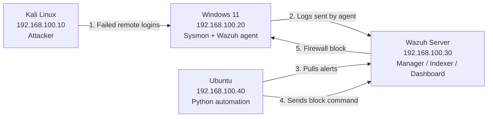

# SOC-Automation-Lab

**Part 2 of 2** | [← Part 1: Attack-Defend Lab](https://github.com/jonasssam/Attack-Defend-Lab)

## Overview

This project is a cybersecurity lab focused on security monitoring, detection, and automated incident response using Wazuh, Sysmon, Python, Windows, and Linux, running on a more complex topology with 4 VMs. It's Part 2 of my [Attack-Defend Lab](https://github.com/jonasssam/Attack-Defend-Lab). In that project I attacked a Windows machine and wrote about what a defender should be able to see. In this one I wanted to actually build the defender's side: get the logs into a SIEM, write my own detection rules, and then have a Python program respond to the alerts automatically without me having to do anything.

The end result: when Kali tries to log in to the Windows machine remotely with a bad password, Wazuh catches it, my Python script picks up the alert, decides it's serious enough to act on, and blocks the attacker's IP in the Windows firewall within a few seconds. Every decision the script makes gets saved to a log.

## Objectives

- Build a virtualized SOC environment
- Centralize and analyze security events using Wazuh
- Write custom detection rules and map them to MITRE ATT&CK
- Develop automated incident response capabilities
- Create a Python program that uses the Wazuh API to trigger defensive actions
- Document the detection and response workflow, including what went wrong along the way

## Lab Architecture

The lab is four virtual machines all connected through one isolated internal network in VirtualBox (named SOC-LAB, 192.168.100.0/24). Each machine got a static IP so they could always find each other. The arrows below show the order things happen in during an attack.



## Environment & Tools

- Kali Linux 2026.2 --> Attack Machine (192.168.100.10)
- Windows 11 --> Monitored Endpoint (192.168.100.20)
- Wazuh 4.14.7 --> SIEM: Manager, Indexer, and Dashboard (192.168.100.30)
- Ubuntu 26.04 LTS --> Automation Server (192.168.100.40)
- Sysmon v15.21 --> Detailed Windows Endpoint Logging
- Python 3.14 --> Automation Engine (requests, python-dotenv, SQLite)
- smbclient --> Generating Failed Remote Logins
- VirtualBox --> Isolated Lab Environment

## Detection & Response Workflow

### 1. Getting Logs Into Wazuh

What I Did: I installed the Wazuh agent on the Windows machine and enrolled it with the Wazuh manager. Then I installed Sysmon with a config file that logs process creation, network connections, and file creation.
Why: Windows' default logs leave out a lot of what happens on the machine, like which processes started and what command line they ran. Sysmon fills in those gaps, and the agent ships everything over to Wazuh so it's all in one place.

**[INSERT IMAGE: 05-wazuh-agent-active.png]**


(Image #1- Windows agent (SOC-Windows) enrolled and active on the Wazuh manager)

**[INSERT IMAGE: 07-sysmon-installed-configured.png]**


(Image #2- Sysmon running with hashing, network connection, and DNS logging enabled)

### 2. Writing Custom Detection Rules

Wazuh comes with a lot of built-in rules, but I wanted to write my own so I understood how detection actually works rather than just relying on defaults. I wrote three rules, and before turning each one on I tested it with wazuh-logtest, which lets you feed a log into Wazuh and see exactly which rule it matches.

| Rule ID | Level | What It Detects | Log Source | MITRE ATT&CK |
|---|---|---|---|---|
| 100100 | 10 | PowerShell run with -EncodedCommand | Sysmon Event ID 1 | T1059.001 |
| 100101 | 8 | A file being created in C:\Users\Public | Sysmon Event ID 11 | T1105 |
| 100102 | 10 | A failed remote login (Logon Type 3) | Security Event ID 4625 | T1110 |

**[INSERT IMAGE: 14-wazuh-rule-test-success.png]**
(Image #3- wazuh-logtest showing a Sysmon file creation event matching rule 100101 with its MITRE mapping)

**Rule 100100 (Encoded PowerShell):** Attackers often base64-encode their PowerShell commands so you can't easily read what they're doing. To test the rule I ran a harmless encoded command (just a Write-Output) and checked that the alert showed up in the dashboard. The alert details include the full encoded command, the parent process, the user, and the integrity level, which is basically everything you'd want if you were the analyst looking into it.

**[INSERT IMAGE: 10-wazuh-dashboard-detection.png]**
(Image #4- Rule 100100 firing in the Wazuh dashboard)

**[INSERT IMAGE: 11-wazuh-event-details.png]**
(Image #5- Alert details showing the encoded command line that triggered the rule)

**Rule 100102 (Failed Remote Login):** Windows logs Event ID 4625 every time a login fails, even if it's just someone mistyping their password at the keyboard. To only catch the suspicious ones, the rule looks for Logon Type 3, which means the login attempt came over the network. I used smbclient on Kali to try logging in to the Windows machine with a wrong password.

**[INSERT IMAGE: 39-windows-4625-remote-authentication.png]**
(Image #6- The failed login on the Windows side: Logon Type 3 coming from Kali at 192.168.100.10)

**[INSERT IMAGE: 41-wazuh-remote-authentication-rule.png]**
(Image #7- The same event in Wazuh, matching rule 100102 with the workstation name KALI and the source IP)

### 3. First Attempt at Automated Response (Didn't Work)

What I Did: Wazuh has a built-in feature called Active Response that can run a script on an agent when a rule fires. I set up the built-in netsh response, which is supposed to block the attacker's IP in the Windows firewall.
Why: It seemed like the simplest way to go from "alert" to "blocked" without writing anything myself.

**[INSERT IMAGE: 38-wazuh-manager-active-response-ready.png]**
(Image #8- The built-in netsh Active Response configured on the Wazuh manager)

The response did trigger, but nothing actually got blocked. When I checked the Active Response log on the Windows machine I found this error:

```
active-response/bin/netsh.exe: Cannot read 'srcip' from data
```

The built-in script looks for the attacker's IP in a field called srcip. That works for Linux logs, but Windows logs store the IP in a different field (win.eventdata.ipAddress), so the script had nothing to block. What made this tricky is that everything looked fine on the dashboard. The alert was there, so unless you went and checked the endpoint itself, you'd assume the attacker had been blocked.

### 4. Building My Own Automation (Worked)

What I Did: I wrote my own Python program on the Ubuntu VM along with a custom Active Response command called block-source-ip.
Why: Writing it myself meant I could read the Windows fields correctly and decide for myself which alerts should actually get a response.

**[INSERT IMAGE: 45-windows-custom-active-response-log.png]**
(Image #9- Top: the built-in script failing on srcip. Bottom: my custom response logging successful BLOCKED and UNBLOCKED actions)

## Automation

The Python program (src/main.py and src/wazuh_client.py) runs in a loop and does the following:

1. Every 5 seconds, it asks the Wazuh Indexer for any new alerts from rules 100100, 100102, and 92057.
2. It looks at the Wazuh rule level of each alert and gives it a severity of LOW, MEDIUM, HIGH, or CRITICAL. Then it decides on an action: LOG, INVESTIGATE, or RESPOND.
3. It pulls the useful details out of the Windows event: the source IP, the username that was targeted, and the logon type.
4. If the action is RESPOND and there's a source IP, it logs in to the Wazuh API, gets a token, and sends the block-source-ip command to only the agent that was attacked.
5. It saves every decision to a SQLite database, including the alerts it decided not to act on.

The Wazuh login info is kept in a .env file that's excluded from Git, so no passwords end up in the repo.

**[INSERT IMAGE: 43-python-source-ip-extraction.png]**
(Image #10- The script reading a failed login alert: HIGH severity, action RESPOND, source IP 192.168.100.10)

**[INSERT IMAGE: 53-soc-automation-final-response.png]**
(Image #11- The code loading credentials from .env, the alert query, and the script detecting and responding live)

**[INSERT IMAGE: 47-python-triggered-windows-containment.png]**
(Image #12- On Windows: I deleted the old block rule, and the automation created it again as an inbound block for 192.168.100.10)

### Not Every Alert Should Get Blocked

One thing I had to think about was when the script should not respond. My encoded PowerShell test also set off a built-in Wazuh rule, 92057, at CRITICAL severity. (It took me a few tries to get this rule to fire at all.) Even though it was the highest severity, there was no attacker IP involved because it was a process running locally, so there was nothing to block. The script marked it INVESTIGATE and left it for a person to look at.

**[INSERT IMAGE: 52-soc-automation-powershell-investigation.png]**
(Image #13- Rule 92057 classified as CRITICAL / INVESTIGATE, with no block sent since there's no source IP)

I think this part matters as much as the blocking itself. If automation blocks everything that looks serious, it ends up breaking things that weren't actually attacks.

### Audit Log

**[INSERT IMAGE: 51-soc-automation-audit-log.png]**
(Image #14- A record in the audit log: time, alert ID, rule, severity, action, source IP, agent, and the API result)

## Troubleshooting

A good amount of this project was fixing things that broke, so I wanted to write down the main ones:

- **The built-in netsh response didn't block anything:** It was looking for a field called srcip that Windows logs don't have (covered above). I fixed it with the custom response and the Python script.
- **The Python login to the Wazuh API returned a 404 error:** I was sending the request to the dashboard address instead of the API, which runs on port 55000. I moved the host and port into the .env file and pointed the script at the right place.
- **The Wazuh Indexer stopped working after a reboot:** The dashboard and my alert queries all failed. I went through journalctl and the indexer logs, checked the network.host setting in opensearch.yml, reset the failed service, and confirmed it was listening on port 9200 again.
- **The Wazuh server was low on memory:** The manager, indexer, and dashboard were all sharing 8 GB with no swap. I tried making a swap file with fallocate, but it gave a "read swap header failed" error on the XFS filesystem. I rebuilt it with dd instead and added it to /etc/fstab so it stays after a reboot.
- **My curl queries to the Indexer returned json_parse_exception:** The JSON was getting broken up by how the shell handled it across multiple lines. I got it working on one line first and then moved all the queries into Python.

**[INSERT IMAGE: 40-wazuh-memory-and-swap.png]**
(Image #15- The fallocate swap file failing on XFS, then rebuilt with dd and confirmed with swapon --show)

## MITRE ATT&CK Mapping

| Lab Activity | ATT&CK Technique | How It Was Detected | Automated Action | Evidence |
|---|---|---|---|---|
| Failed remote logins from Kali | T1110 | Rule 100102 (Event 4625, Logon Type 3) | Source IP blocked | Img 6, 7, 12 |
| Encoded PowerShell | T1059.001 | Rule 100100 (Sysmon Event 1) | Investigate (no IP to block) | Img 4, 5, 13 |
| File dropped in Public folder | T1105 | Rule 100101 (Sysmon Event 11) | Alert only | Img 3 |

## Key Findings

- An alert showing up doesn't mean the response worked. You have to check the result on the endpoint
- Windows and Linux logs store the same info under different field names, and that breaks tools that expect one format
- Automation needs rules for when not to act, not just when to act
- Custom rules should be tested with wazuh-logtest before they go live
- A SIEM is resource-heavy, and keeping it running was a big part of the work

## Lessons Learned

- Learned how to write Wazuh rules from scratch, test them with wazuh-logtest, and map them to MITRE ATT&CK techniques
- Learned how to use the Wazuh API and Indexer from Python, including logging in with a token and searching for specific alerts
- Learned to read the logs on the endpoint when something seems to work but doesn't. The netsh issue only showed up in the agent's Active Response log
- Learned how to keep passwords out of my code by using a .env file
- Learned how to troubleshoot Linux services with journalctl, systemctl, and checking which ports are listening

Some things I'd improve next time:
- The script currently skips certificate checking (verify=False) because the lab uses Wazuh's self-signed certificates. The proper fix is to trust Wazuh's certificate
- The lab still uses the default Wazuh passwords. It's an isolated network and they're not in the repo, but they should be changed
- Right now one failed login is enough to get blocked. A better rule would wait for something like 5 failures within a minute, so a user who mistypes their password doesn't get locked out
- I'd like to add a rule that catches the exact Meterpreter attack from Part 1, like an unknown program making an outbound connection (Sysmon Event ID 3)

Going back to Part 1, that project ended with a list of things a defender could watch for. This one turned some of those ideas into real detections and an automatic response, which is what I set out to do.

The biggest takeaway from this project was that detecting something and actually responding to it are two separate problems. Getting an alert was the easier part. Making sure the response really happened, and only happened when it should, is what took the most work.

## Disclaimer

This project was conducted fully and exclusively in an isolated virtual lab environment using systems owned and controlled by me. No outside systems, networks, or individuals were targeted. Everything here was done for educational and defensive security purposes.
